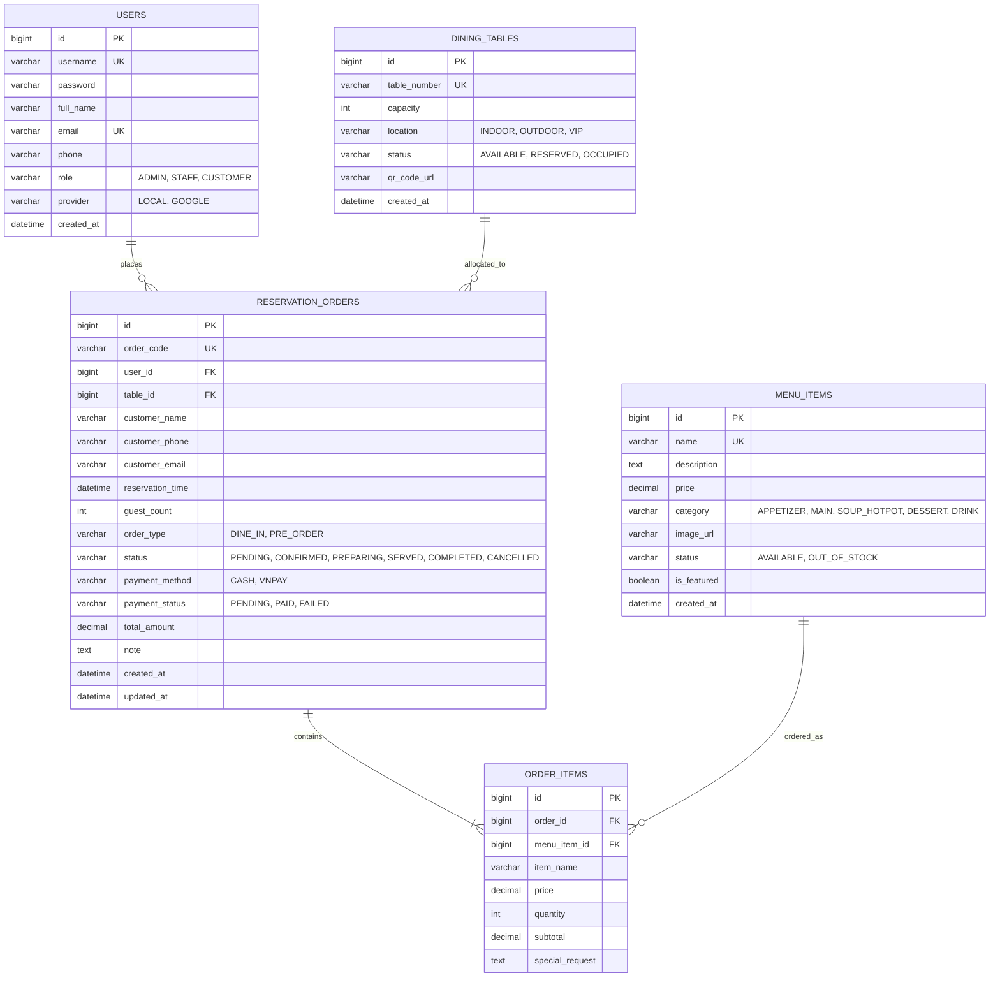
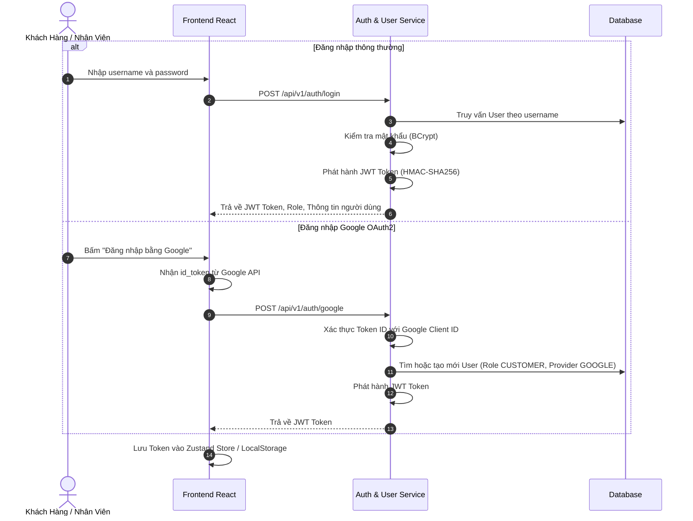
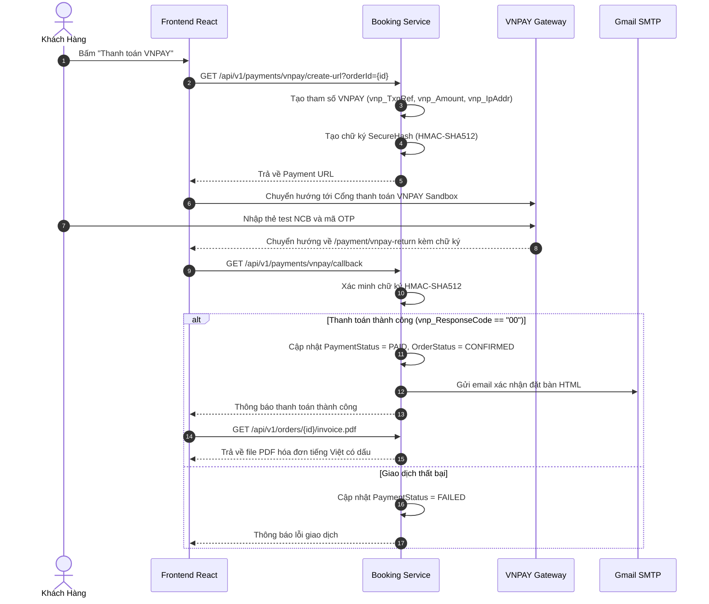

# Báo Cáo Đồ Án J2EE: Hệ Thống Quản Lý Đặt Bàn Và Gọi Món Trực Tuyến - Nhà Hàng Ẩm Thực Bếp Việt

---

## Mục Lục

1. [Giới Thiệu Và Đặt Vấn Đề](#1-giới-thiệu-và-đặt-vấn-đề)
2. [Phân Tích Nghiệp Vụ Và Yêu Cầu Người Dùng](#2-phân-tích-nghiệp-vụ-và-yêu-cầu-người-dùng)
3. [Kiến Trúc Kỹ Thuật Và Công Nghệ](#3-kiến-trúc-kỹ-thuật-và-công-nghệ)
4. [Thiết Kế Cơ Sở Dữ Liệu Và Sơ Đồ ERD](#4-thiết-kế-cơ-sở-dữ-liệu-và-sơ-đồ-erd)
5. [Thiết Kế Các Luồng Nghiệp Vụ Trọng Yếu](#5-thiết-kế-các-luồng-nghiệp-vụ-trọng-yếu)
   - [5.1. Luồng Xác Thực Bảo Mật JWT Và Google OAuth2](#51-luồng-xác-thực-bảo-mật-jwt-và-google-oauth2)
   - [5.2. Luồng Quét Mã QR Gọi Món Tại Bàn](#52-luồng-quét-mã-qr-gọi-món-tại-bàn)
   - [5.3. Luồng Đặt Bàn Chống Trùng Khung Giờ](#53-luồng-đặt-bàn-chống-trùng-khung-giờ)
   - [5.4. Luồng Thanh Toán Trực Tuyến VNPAY Và Xuất Hóa Đơn PDF](#54-luồng-thanh-toán-trực-tuyến-vnpay-và-xuất-hóa-đơn-pdf)
   - [5.5. Trợ Lý AI Gợi Ý Mâm Cơm Bếp Việt](#55-trợ-lý-ai-gợi-ý-mâm-cơm-bếp-việt)
6. [Kế Hoạch Kiểm Thử Và Đảm Bảo Chất Lượng](#6-kế-hoạch-kiểm-thử-và-đảm-bảo-chất-lượng)
7. [Hướng Dẫn Triển Khai Đóng Gói Và Vận Hành](#7-hướng-dẫn-triển-khai-đóng-gói-và-vận-hành)
8. [Kết Luận Và Hướng Phát Triển](#8-kết-luận-và-hướng-phát-triển)

---

## 1. Giới Thiệu Và Đặt Vấn Đề

### 1.1. Bối cảnh đề tài

Trong xu thế số hóa ngành dịch vụ ẩm thực (F&B - Food and Beverage), các nhà hàng truyền thống gặp nhiều thách thức trong việc tối ưu hóa quy trình phục vụ:
- Khách hàng phải chờ đợi nhân viên mang menu giấy, gọi món thủ công dễ nhầm lẫn.
- Việc đặt bàn trước qua điện thoại thường xuyên xảy ra tình trạng trùng lặp giờ hoặc vượt quá sức chứa.
- Quy trình thanh toán tiền mặt tại quầy vào giờ cao điểm gây ùn tắc, thiếu minh bạch và không thể tự động lưu trữ hóa đơn điện tử.
- Nhân viên bếp khó theo dõi thứ tự chế biến, tình trạng đơn hàng dễ bị sót hoặc phục vụ trễ.

### 1.2. Mục tiêu của đồ án

Đồ án "Hệ Thống Quản Lý Đặt Bàn Và Gọi Món Trực Tuyến - Nhà Hàng Ẩm Thực Bếp Việt" được thiết kế và xây dựng nhằm giải quyết toàn diện các vấn đề trên thông qua:
1. Cho phép thực khách quét mã QR tại bàn để trực tiếp tra cứu thực đơn và gọi món mà không cần tải ứng dụng native.
2. Cho phép khách hàng đặt bàn trực tuyến có cơ chế khóa khung giờ chống trùng thông minh.
3. Cung cấp màn hình điều phối cho Bếp và Nhân viên phục vụ cập nhật trạng thái đơn theo thời gian thực.
4. Tích hợp cổng thanh toán trực tuyến quốc gia VNPAY và xuất hóa đơn PDF tiếng Việt đạt chuẩn.
5. Ứng dụng trí tuệ nhân tạo (AI Recommendation) hỗ trợ gợi ý mâm cơm truyền thống tối ưu theo ngân sách và số lượng thực khách.
6. Xây dựng theo kiến trúc Microservices chuẩn doanh nghiệp trên nền tảng Spring Boot 3.4.x và React 19.

---

## 2. Phân Tích Nghiệp Vụ Và Yêu Cầu Người Dùng

Hệ thống phục vụ 3 nhóm đối tượng người dùng chính với 5 User Stories cốt lõi:

### 2.1. Phân nhóm người dùng
- **Khách vãng lai (Anonymous User)**: Chưa đăng nhập, có thể xem thông tin nhà hàng, duyệt thực đơn theo danh mục, tra cứu sơ đồ bàn trống, và quét mã QR tại bàn.
- **Khách hàng thân thiết (Customer)**: Đã có tài khoản (đăng ký thông thường hoặc Google OAuth2), có quyền đặt bàn trước, gửi đơn gọi món, thanh toán qua VNPAY, nhận email xác nhận, và xem lại lịch sử đơn hàng.
- **Nhân viên phục vụ và Bếp (Staff)**: Sử dụng Màn hình Bếp (Kitchen Order Board) để nhận đơn, chuyển đổi trạng thái chế biến (Đang nấu, Đã phục vụ), điều phối bàn ăn và thu tiền mặt tại quầy.
- **Quản trị viên (Admin)**: Toàn quyền quản lý danh mục món ăn (tải ảnh Cloudinary), quản lý danh sách bàn và in mã QR, quản lý tài khoản người dùng, xem biểu đồ doanh thu và báo cáo thống kê.

---

## 3. Kiến Trúc Kỹ Thuật Và Công Nghệ

### 3.1. Mô hình kiến trúc Microservices

Hệ thống được chia thành 3 dịch vụ độc lập (loosely coupled) giao tiếp qua REST API:

```text
                               +----------------------------------+
                               |     Frontend Client (React 19)   |
                               |    Port: 5173 / Port 80 (Nginx)  |
                               +-----------------+----------------+
                                                 |
                   +-----------------------------+-----------------------------+
                   |                             |                             |
                   v                             v                             v
        +--------------------+        +--------------------+        +--------------------+
        | Auth & User Service|        |Catalog & Table Svc |        |Booking & Order Svc |
        |     Port: 8081     |        |     Port: 8082     |        |     Port: 8083     |
        +---------+----------+        +---------+----------+        +---------+----------+
                  |                             |                             |
                  |                             +--------------+              |
                  |                                            | (RestClient) |
                  |                                            v              |
                  +-----------------------------+--------------+--------------+
                                                |
                                                v
                                     +--------------------+
                                     |   MySQL 8.0 / H2   |
                                     |  restaurant_db     |
                                     +--------------------+
```

### 3.2. Công nghệ sử dụng
- **Backend**:
  - Ngôn ngữ: Java 17.
  - Framework: Spring Boot 3.4.1, Spring Data JPA, Spring Security 6.
  - Bảo mật: JJWT (io.jsonwebtoken 0.12.6) với HMAC-SHA256, PasswordEncoder BCrypt.
  - Thư viện mã QR: Google ZXing 3.5.3.
  - Kết xuất hóa đơn: OpenPDF 2.0.3 (hỗ trợ font tiếng Việt Unicode).
  - Tải ảnh đám mây: Cloudinary Java SDK 1.39.0.
  - Gửi email: Spring Boot Starter Mail (JavaMailSender với Gmail SMTP TLS).
- **Frontend**:
  - Thư viện chính: React 19, TypeScript 5.7.
  - Công cụ đóng gói: Vite 6.
  - Giao diện: Tailwind CSS v3, Lucide React Icons.
  - Quản lý trạng thái: Zustand 5.0 (lưu phiên đăng nhập và giỏ hàng).
  - Điều hướng: React Router DOM v7.
- **Hạ tầng & Đóng gói**:
  - Multi-stage Dockerfile cho từng service và frontend.
  - Docker Compose điều phối đa container (MySQL + 3 Services + Frontend).
  - Heroku Procfile và Vercel routing configuration.

---

## 4. Thiết Kế Cơ Sở Dữ Liệu Và Sơ Đồ ERD

Cơ sở dữ liệu quan hệ gồm các thực thể chính với các mối quan hệ chặt chẽ:



---

## 5. Thiết Kế Các Luồng Nghiệp Vụ Trọng Yếu

### 5.1. Luồng Xác Thực Bảo Mật JWT Và Google OAuth2



### 5.2. Luồng Quét Mã QR Gọi Món Tại Bàn

1. Khách hàng ngồi tại bàn ăn và dùng camera điện thoại quét mã QR dán trên bàn.
2. Mã QR chứa liên kết `http://<domain>/table/{tableNumber}` (ví dụ: `/table/B01`).
3. Ứng dụng Frontend tự động kích hoạt chế độ gọi món tại bàn, gán cứng mã bàn vào giỏ hàng (`useCartStore`).
4. Khách hàng lựa chọn món ăn từ thực đơn, điều chỉnh số lượng và ghi chú chế biến.
5. Khách hàng bấm gửi đơn gọi món, đơn hàng được tạo với loại `DINE_IN` gắn liền số bàn.
6. Màn hình Bếp (Kitchen Order Board) của nhà hàng ngay lập tức hiển thị đơn món cần chuẩn bị.

### 5.3. Luồng Đặt Bàn Chống Trùng Khung Giờ

Để đảm bảo không bị quá tải hoặc đặt trùng bàn, `BookingOrderService` thực hiện thuật toán kiểm tra:
1. Tiếp nhận yêu cầu đặt bàn gồm: `tableId`, `reservationTime` (thời điểm nhận bàn) và `guestCount`.
2. Kiểm tra sức chứa bàn: Sức chứa của bàn phải lớn hơn hoặc bằng `guestCount`.
3. Kiểm tra khung giờ: Khoảng thời gian bảo lưu cho mỗi lượt ăn là 2 giờ ($\pm 2$ tiếng).
4. Thực hiện truy vấn kiểm tra các đơn đặt bàn hiện hành của bàn đó trong khoảng:
   $$[\text{reservationTime} - 2\text{ giờ}, \text{reservationTime} + 2\text{ giờ}]$$
   với trạng thái đơn không phải `CANCELLED` hoặc `COMPLETED`.
5. Nếu phát hiện đơn xung đột, hệ thống chặn tạo đơn và thông báo lỗi rõ ràng tới khách hàng.

### 5.4. Luồng Thanh Toán Trực Tuyến VNPAY Và Xuất Hóa Đơn PDF



### 5.5. Trợ Lý AI Gợi Ý Mâm Cơm Bếp Việt

Dịch vụ `AiRecommendationService` cung cấp khả năng tự động phối hợp thực đơn truyền thống:
- Đầu vào: Số lượng thực khách và ngân sách dự kiến.
- Thuật toán phối mâm cơm: Tự động cân đối tỷ lệ món theo văn hóa ẩm thực Việt Nam (Món khai vị, Món chính thịt/cá, Canh/Lẩu, Món rau, Cơm trắng và Tráng miệng).
- Đảm bảo tổng giá tiền nằm trong giới hạn ngân sách và tối ưu hóa trải nghiệm ẩm thực.

---

## 6. Kế Hoạch Kiểm Thử Và Đảm Bảo Chất Lượng

Hệ thống áp dụng phương pháp kiểm thử tự động toàn diện trước khi phát hành:
- **Unit Test**: Kiểm thử độc lập từng tầng Service sử dụng Mockito và JUnit 5.
  - `AuthServiceTest`: Kiểm tra đăng ký, đăng nhập mật khẩu và Google OAuth2.
  - `BookingOrderServiceTest`: Kiểm tra logic tạo đơn, tính tiền, chống trùng khung giờ.
  - `StaffOrderServiceTest`: Kiểm tra logic cập nhật trạng thái đơn và thanh toán tiền mặt.
  - `VnPayServiceTest`: Kiểm tra tạo URL và thuật toán chữ ký bảo mật HMAC-SHA512.
  - `PdfInvoiceServiceTest`: Kiểm tra kết xuất hóa đơn PDF có đầy đủ nội dung.
  - `StatisticsServiceTest`: Kiểm tra thuật toán tổng hợp doanh thu theo kỳ.
  - `CatalogPublicServiceTest`: Kiểm tra truy vấn thực đơn và danh sách bàn.
- **Integration Test**: Kiểm thử tích hợp tầng Controller và phân quyền Spring Security (`@WithMockUser`).
  - `AdminCatalogControllerTest`, `PublicMenuControllerTest`, `PublicTableControllerTest`.
  - `BookingCustomerControllerTest`, `StaffOrderControllerTest`.
- **Frontend Verification**: Biên dịch TypeScript nghiêm ngặt (`tsc -b`) và đóng gói tài nguyên tĩnh qua Vite (`vite build`).
- **Kịch bản kiểm tra tập trung**: Lệnh `npm run verify` chạy tự động toàn bộ 24 test case của backend và build frontend, đạt tỷ lệ 100% thành công với zero lỗi.

---

## 7. Hướng Dẫn Triển Khai Đóng Gói Và Vận Hành

### 7.1. Đóng gói Container với Docker
Mỗi microservice sở hữu multi-stage Dockerfile giúp tối ưu dung lượng ảnh:
- Giai đoạn 1 (Builder): Sử dụng `eclipse-temurin:17-jdk-alpine` biên dịch mã nguồn qua Maven Wrapper.
- Giai đoạn 2 (Runtime): Sử dụng `eclipse-temurin:17-jre-alpine`, chạy dưới tài khoản non-root `appuser` để đảm bảo an ninh.
- Frontend: Sử dụng `node:20-alpine` build static files và phục vụ bằng `nginx:alpine`.

### 7.2. Triển khai Đa Container bằng Docker Compose
Tệp `docker-compose.yml` tại thư mục gốc quản lý toàn bộ hệ thống gồm MySQL 8.0, 3 microservices backend và giao diện frontend với cơ chế kiểm tra trạng thái hoạt động (healthcheck) tự động.

### 7.3. Triển khai Cloud (Heroku & Vercel)
- Backend: Sẵn sàng triển khai lên Heroku thông qua `backend/Procfile` và `backend/system.properties` khai báo Java 17.
- Frontend: Sẵn sàng triển khai lên Vercel thông qua `frontend/vercel.json` hỗ trợ định tuyến SPA.

---

## 8. Kết Luận Và Hướng Phát Triển

### 8.1. Kết quả đạt được
- Xây dựng thành công hệ thống hoàn chỉnh theo kiến trúc Microservices phân tán hiện đại.
- Triển khai đầy đủ 5 User Stories với chất lượng mã nguồn đạt chuẩn sản phẩm thực tế, không sử dụng dữ liệu giả (mock/fake code).
- Tích hợp thành công các giải pháp công nghệ tiên tiến: Google ZXing sinh QR, VNPAY Sandbox thanh toán HMAC-SHA512, OpenPDF sinh hóa đơn tiếng Việt, Cloudinary lưu trữ ảnh đám mây, và Gmail SMTP gửi thông báo.
- Giao diện người dùng sắc sảo, tối ưu trải nghiệm trên mọi kích thước màn hình từ điện thoại đến máy tính bảng và máy tính bàn.
- Đạt 100% bài kiểm thử tự động với quy trình xác minh chất lượng chặt chẽ.

### 8.2. Hướng phát triển tiếp theo
- Nâng cấp cơ chế đồng bộ thời gian thực giữa Bếp và Bàn ăn thông qua giao thức WebSocket / STOMP.
- Bổ sung ứng dụng di động cho nhân viên phục vụ nhận order tại bàn.
- Mở rộng thêm cổng thanh toán ví điện tử MoMo, ZaloPay và thẻ thanh toán quốc tế Visa/MasterCard.
