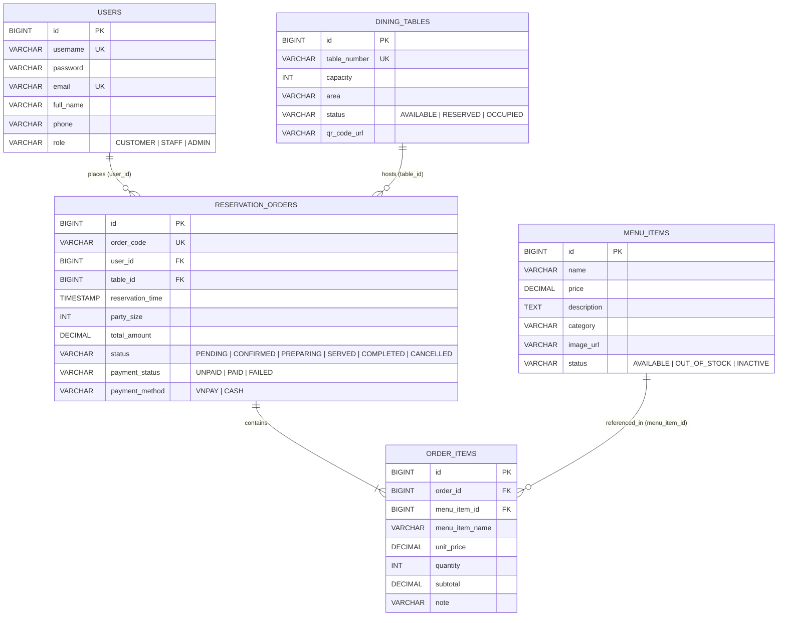

# Mô Hình Dữ Liệu Chi Tiết (Phase 1 Data Model)

**Tính năng**: Hệ Thống Quản Lý Đặt Bàn và Gọi Món Trực Tuyến Cho Nhà Hàng (`001-qr-table-ordering`)  
**Ngày tạo**: 2026-10-13

---

## 1. Sơ Đồ Quan Hệ Thực Thể (5 Thực Thể Cốt Lõi Trên 3 Microservices)

Hệ thống được thiết kế tinh gọn với **5 thực thể cốt lõi** (vượt yêu cầu tối thiểu 3 thực thể, chặt chẽ, dễ bảo vệ đồ án), phân bổ vào 3 Microservices theo đúng ranh giới nghiệp vụ:

---

## 2. Chi Tiết Các Thực Thể Theo Từng Microservice

### 2.1. Service 1 (`auth-user-service` - Port 8081): Thực thể `User` (Bảng `users`)

Lưu trữ thông tin tài khoản người dùng và phân quyền truy cập.

| Trường (Field) | Kiểu dữ liệu (DB / Java) | Ràng buộc (Constraints) | Mô tả |
|---|---|---|---|
| `id` | `BIGINT` / `Long` | PK, Auto Increment | Định danh người dùng |
| `username` | `VARCHAR(60)` / `String` | UNIQUE, NOT NULL | Tên đăng nhập |
| `password` | `VARCHAR(255)` / `String` | NOT NULL | Mật khẩu đã mã hóa BCrypt |
| `email` | `VARCHAR(120)` / `String` | UNIQUE, NOT NULL | Địa chỉ email nhận xác nhận đặt bàn |
| `full_name` | `VARCHAR(120)` / `String` | NOT NULL | Họ và tên khách hàng / nhân viên |
| `phone` | `VARCHAR(20)` / `String` | NOT NULL | Số điện thoại liên hệ |
| `role` | `VARCHAR(20)` / `UserRole` | NOT NULL | Enum: `CUSTOMER`, `STAFF`, `ADMIN` |
| `active` | `BOOLEAN` / `boolean` | NOT NULL, Default `true` | Trạng thái hoạt động của tài khoản |
| `created_at` | `TIMESTAMP` / `Instant` | NOT NULL | Thời điểm tạo tài khoản |

---

### 2.2. Service 2 (`catalog-table-service` - Port 8082): Thực thể `DiningTable` & `MenuItem`

#### A. Bàn ăn (`DiningTable` - Bảng `dining_tables`)

| Trường (Field) | Kiểu dữ liệu (DB / Java) | Ràng buộc (Constraints) | Mô tả |
|---|---|---|---|
| `id` | `BIGINT` / `Long` | PK, Auto Increment | Định danh bàn ăn |
| `table_number` | `VARCHAR(30)` / `String` | UNIQUE, NOT NULL | Số hiệu bàn (ví dụ: `T01`, `T02`, `VIP-01`) |
| `capacity` | `INT` / `Integer` | NOT NULL, Check `>= 1` | Sức chứa (số ghế tối đa) |
| `area` | `VARCHAR(60)` / `String` | NOT NULL, Default `'Tầng 1'` | Khu vực bàn (Tầng 1, Sân vườn, Phòng VIP) |
| `status` | `VARCHAR(20)` / `TableStatus` | NOT NULL | Enum: `AVAILABLE` (Trống), `RESERVED` (Đã đặt), `OCCUPIED` (Đang dùng) |
| `qr_code_url` | `VARCHAR(500)` / `String` | NOT NULL | Đường dẫn QR dẫn tới trang xem thực đơn/gọi món tại bàn (`/table/{tableNumber}`) |
| `created_at` | `TIMESTAMP` / `Instant` | NOT NULL | Thời điểm tạo |
| `updated_at` | `TIMESTAMP` / `Instant` | NOT NULL | Thời điểm cập nhật |

#### B. Món ăn (`MenuItem` - Bảng `menu_items`)

| Trường (Field) | Kiểu dữ liệu (DB / Java) | Ràng buộc (Constraints) | Mô tả |
|---|---|---|---|
| `id` | `BIGINT` / `Long` | PK, Auto Increment | Định danh món ăn |
| `name` | `VARCHAR(150)` / `String` | NOT NULL, Index | Tên món ăn / đồ uống |
| `price` | `DECIMAL(12,2)` / `BigDecimal` | NOT NULL, Check `>= 0` | Đơn giá bán (VNĐ) |
| `description` | `TEXT` / `String` | NULLABLE | Mô tả chi tiết món ăn |
| `category` | `VARCHAR(80)` / `String` | NOT NULL, Index | Danh mục món (ví dụ: `Khai vị`, `Món chính`, `Đồ uống`, `Tráng miệng`) |
| `image_url` | `VARCHAR(500)` / `String` | NULLABLE | Đường dẫn ảnh món ăn (lưu trên Cloudinary) |
| `status` | `VARCHAR(20)` / `MenuItemStatus` | NOT NULL | Enum: `AVAILABLE` (Còn món), `OUT_OF_STOCK` (Hết món), `INACTIVE` (Ngừng bán) |
| `created_at` | `TIMESTAMP` / `Instant` | NOT NULL | Thời điểm tạo |
| `updated_at` | `TIMESTAMP` / `Instant` | NOT NULL | Thời điểm cập nhật |

---

### 2.3. Service 3 (`booking-order-service` - Port 8083): Thực thể `ReservationOrder` & `OrderItem`

#### A. Đặt bàn & Đơn gọi món/Hóa đơn (`ReservationOrder` - Bảng `reservation_orders`)
Thực thể trung tâm kết nối nghiệp vụ đặt bàn theo khung giờ, gọi món tại bàn và thanh toán hóa đơn.

| Trường (Field) | Kiểu dữ liệu (DB / Java) | Ràng buộc (Constraints) | Mô tả |
|---|---|---|---|
| `id` | `BIGINT` / `Long` | PK, Auto Increment | Định danh đơn đặt bàn / hóa đơn |
| `order_code` | `VARCHAR(40)` / `String` | UNIQUE, NOT NULL, Index | Mã đơn hiển thị & gửi qua Email (ví dụ: `ORD-20261013-001`) |
| `user_id` | `BIGINT` / `Long` | NOT NULL, Index | ID của khách hàng đã đăng nhập (`User.id`) |
| `customer_name` | `VARCHAR(120)` / `String` | NOT NULL | Tên khách hàng tại thời điểm đặt |
| `customer_email` | `VARCHAR(120)` / `String` | NOT NULL | Email khách hàng để gửi xác nhận tự động |
| `customer_phone` | `VARCHAR(20)` / `String` | NOT NULL | Số điện thoại liên hệ |
| `table_id` | `BIGINT` / `Long` | NOT NULL, Index | ID bàn ăn (`DiningTable.id`) |
| `table_number` | `VARCHAR(30)` / `String` | NOT NULL | Số hiệu bàn sao lưu tại thời điểm đặt |
| `reservation_time` | `TIMESTAMP` / `Instant` | NOT NULL, Index | Thời gian đặt bàn / thời điểm dùng bữa |
| `party_size` | `INT` / `Integer` | NOT NULL, Check `>= 1` | Số lượng khách |
| `total_amount` | `DECIMAL(12,2)` / `BigDecimal` | NOT NULL, Default `0` | Tổng tiền hóa đơn (bằng tổng `subtotal` của các `OrderItem`) |
| `status` | `VARCHAR(20)` / `OrderStatus` | NOT NULL | Enum: `PENDING`, `CONFIRMED`, `PREPARING`, `SERVED`, `COMPLETED`, `CANCELLED` |
| `payment_method` | `VARCHAR(20)` / `PaymentMethod` | NOT NULL, Default `'VNPAY'` | Enum: `VNPAY`, `CASH` |
| `payment_status` | `VARCHAR(20)` / `PaymentStatus` | NOT NULL, Default `'UNPAID'` | Enum: `UNPAID`, `PAID`, `FAILED` |
| `vnp_txn_ref` | `VARCHAR(64)` / `String` | UNIQUE, NULLABLE | Mã tham chiếu giao dịch thanh toán VNPAY |
| `email_sent` | `BOOLEAN` / `boolean` | NOT NULL, Default `false` | Đánh dấu đã gửi email xác nhận thành công |
| `note` | `VARCHAR(500)` / `String` | NULLABLE | Ghi chú đặt bàn / gọi món |
| `created_at` | `TIMESTAMP` / `Instant` | NOT NULL | Thời điểm tạo đơn |
| `updated_at` | `TIMESTAMP` / `Instant` | NOT NULL | Thời điểm cập nhật gần nhất |

#### B. Chi tiết món đặt (`OrderItem` - Bảng `order_items`)

| Trường (Field) | Kiểu dữ liệu (DB / Java) | Ràng buộc (Constraints) | Mô tả |
|---|---|---|---|
| `id` | `BIGINT` / `Long` | PK, Auto Increment | Định danh dòng chi tiết món |
| `order_id` | `BIGINT` / `Long` | FK -> `reservation_orders(id)`, NOT NULL | Đơn hàng / Đặt bàn chứa món này |
| `menu_item_id` | `BIGINT` / `Long` | NOT NULL | ID món ăn (`MenuItem.id`) |
| `menu_item_name` | `VARCHAR(150)` / `String` | NOT NULL | Tên món sao lưu tại thời điểm đặt |
| `unit_price` | `DECIMAL(12,2)` / `BigDecimal` | NOT NULL, Check `>= 0` | Đơn giá tại thời điểm đặt |
| `quantity` | `INT` / `Integer` | NOT NULL, Check `>= 1` | Số lượng món |
| `subtotal` | `DECIMAL(12,2)` / `BigDecimal` | NOT NULL, Check `>= 0` | Thành tiền (`quantity * unit_price`) |
| `note` | `VARCHAR(300)` / `String` | NULLABLE | Ghi chú khẩu vị (ít đá, không cay...) |

---

## 3. Vòng Đời Trạng Thái Đơn Hàng & Bàn Ăn (State Transitions)

1. **Khi khách hàng tạo đặt bàn trước (`PENDING`)**:
   - Kiểm tra bàn có đủ ghế (`capacity >= party_size`) và không bị trùng đơn đang hoạt động trong khung giờ `reservation_time` (+/- 2 giờ).
   - Cập nhật trạng thái bàn sang `RESERVED`.
   - Tự động gửi Email xác nhận mã đặt bàn (`order_code`) tới `customer_email`.
2. **Khi nhân viên xác nhận đơn đặt bàn (`CONFIRMED`)**:
   - Đơn chuyển sang `CONFIRMED`, bàn giữ trạng thái `RESERVED` (hoặc chuyển sang `OCCUPIED` khi khách ngồi vào bàn).
3. **Khi khách chọn món / gửi order và Bếp chế biến (`PREPARING` -> `SERVED`)**:
   - Bàn ở trạng thái `OCCUPIED`.
   - Nhân viên/Bếp cập nhật trạng thái đơn từ `CONFIRMED` / `PENDING` -> `PREPARING` (Đang nấu) -> `SERVED` (Đã phục vụ).
4. **Khi thanh toán trực tuyến qua VNPAY hoặc tại quầy (`COMPLETED`)**:
   - Khi callback VNPAY hợp lệ (hoặc nhân viên xác nhận thu tiền mặt), `payment_status` chuyển sang `PAID`, `status` đơn chuyển sang `COMPLETED`.
   - Trạng thái bàn (`DiningTable.status`) tự động chuyển về `AVAILABLE` (Trống).
5. **Khi hủy đơn (`CANCELLED`)**:
   - Nếu đơn bị hủy trước khi phục vụ, `status` chuyển sang `CANCELLED` và trạng thái bàn được giải phóng về `AVAILABLE`.
